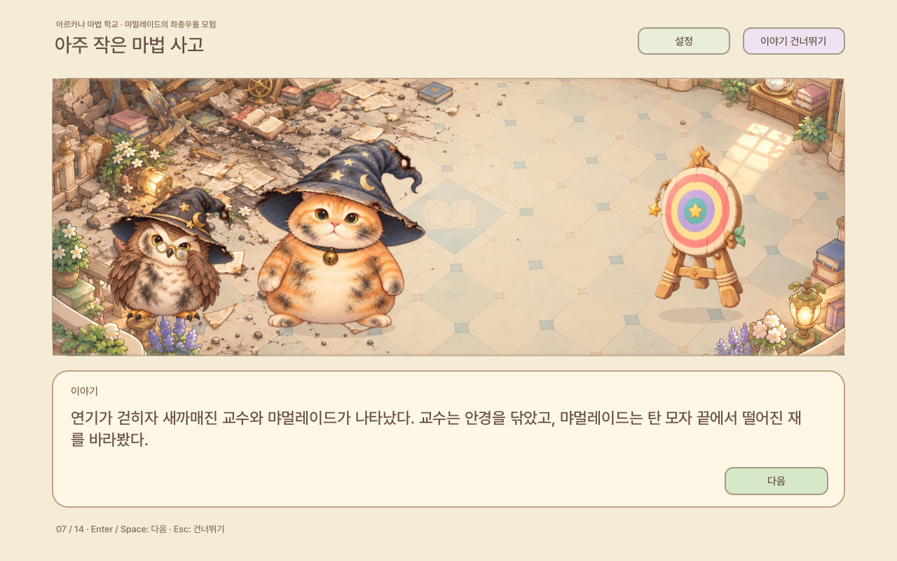
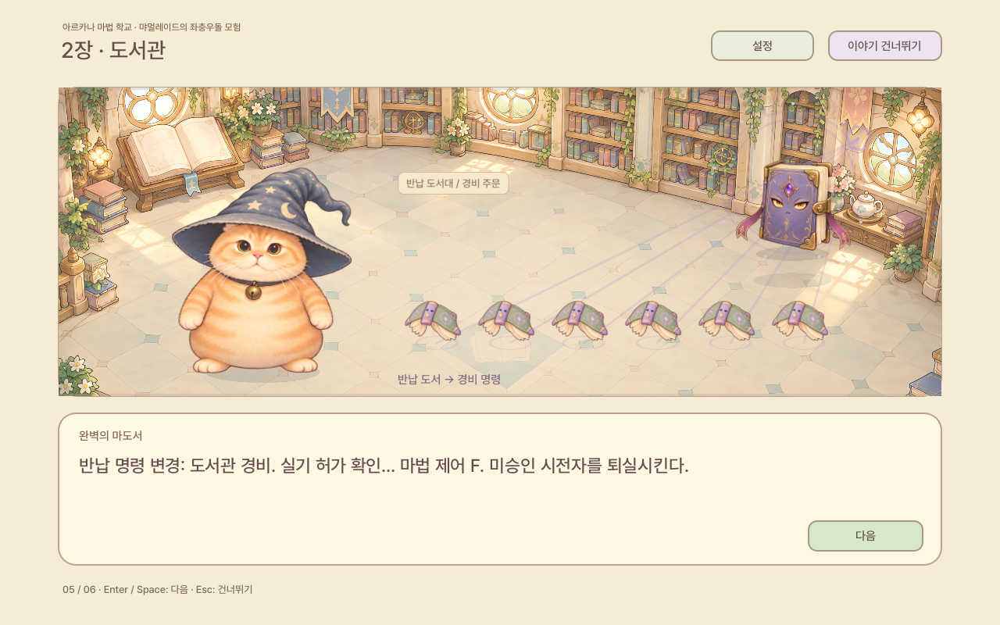

# Meowgnificent the wizard cat — v0.14.0

— 실수의 흔적과 깨어나는 스테이지

과녁이 먀멀레이드를 향하도록 방향을 바로잡았습니다. 불꽃이 뒤로 돌아 터진 뒤에는 왼쪽 벽과 책장이 무너진 교실이 남습니다. 교수와 고양이는 탄 모자, 먼지 낀 안경, 그을린 털·깃털을 가진 전용 그림으로 바뀝니다. 연기가 가라앉거나 대사가 바뀌어도 같은 장소의 파손과 그을음은 유지됩니다.

도서관의 반납 주문이 경비 명령으로 바뀌는 과정, 물약 재배장의 보호 주문이 방문자 퇴거 명령으로 바뀌는 과정을 대사와 움직임으로 보여 줍니다. 문양→각성→정렬/뿌리 뽑기→명령에 따른 공격을 순서대로 재생하며, 설명을 기다리기 전에 공격을 끝내 버리지 않습니다. 실제 스테이지의 책·버섯과 연결하고, 배경에 그려져 겹치던 개체도 정리했습니다. 모스의 덩굴과 블룹의 실패한 물약에도 작은 흔적을 더했습니다.

새 그을림 그림과 파손 배경은 기존 파스텔 스토리북 스타일에 맞췄습니다. 기존 스토리·마법·장비·영구 성장과 대화 연속성, 줍기·출구 개선을 유지합니다. [연출 설계](STORY-DETAIL-v0.14.0.md), [검증 범위](QA-v0.14.0.md).

## 검증

소스1777개 / 35suite, Windows/Wine와Linux 실행각25개, Web48개 검사를 통과했습니다. 같은 세 시퀀스의 실제 소프트웨어 렌더링도 비교했습니다. Mac은 구조와 서명 해시 검증이며 실기 실행은 별도 범위입니다.

Download a ZIP, extract it into a new folder, and launch the executable/app. No MSI installer or CMD download command is needed.

- [Meowgnificent-v0.14.0-windows.zip](https://github.com/forhide/Stone-Quotation/raw/refs/heads/meowgnificent-downloads-v0.14.0/Meowgnificent-v0.14.0-windows.zip)
- [Meowgnificent-v0.14.0-linux.zip](https://github.com/forhide/Stone-Quotation/raw/refs/heads/meowgnificent-downloads-v0.14.0/Meowgnificent-v0.14.0-linux.zip)
- [Meowgnificent-v0.14.0-macos.zip](https://github.com/forhide/Stone-Quotation/raw/refs/heads/meowgnificent-downloads-v0.14.0/Meowgnificent-v0.14.0-macos.zip)
- [Meowgnificent-v0.14.0-web.zip](https://github.com/forhide/Stone-Quotation/raw/refs/heads/meowgnificent-downloads-v0.14.0/Meowgnificent-v0.14.0-web.zip)
- [Meowgnificent-v0.14.0-source.zip](https://github.com/forhide/Stone-Quotation/raw/refs/heads/meowgnificent-downloads-v0.14.0/Meowgnificent-v0.14.0-source.zip)

Controls: WASD/arrows move, mouse aim, click/Space cast, Q/right-click equipped special skill, Shift+direction roll, I equipment, E nearby interaction/open exit, T talk to Pip, Enter start/next cleared area, M legacy studies, Esc close/pause, R abandon. Story: Enter/Space advance; Esc skip. F10: language, window mode and frame-limit settings. Shop/legacy: click or 1–4.

Validation: 1777 source checks including 121 item-skill checks; 25 Windows/Wine and 25 Linux executable checks; 23 Web gameplay checks, 10 default-story English checks and 15 default Korean/language-switch/persistence Web checks. Mac package metadata, arm64, permissions and ad-hoc signature hashes are validated; actual Mac launch and native Windows hardware performance are untested. See QA-v0.14.0.md and qa/ for the exact scope, visual reviews and sequential render measurements.

The Mac app is ad-hoc signed and not Apple-notarized. Read PLAY-MACOS.txt in the ZIP. Checksums are in Meowgnificent-v0.14.0-SHA256SUMS.txt.

