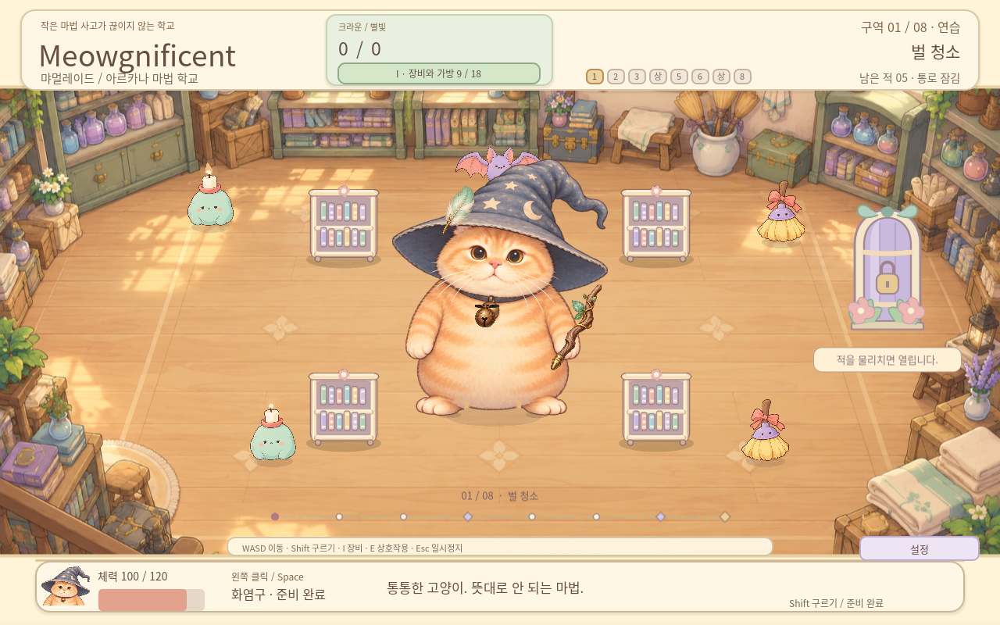
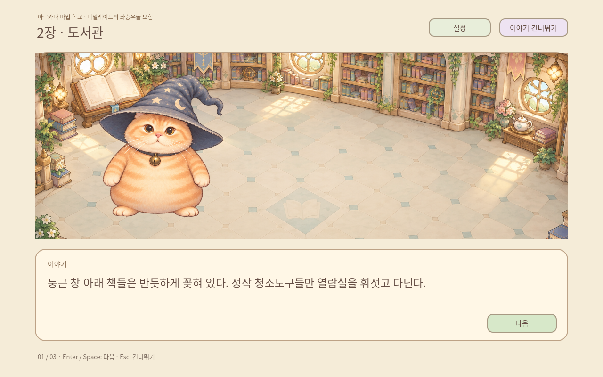
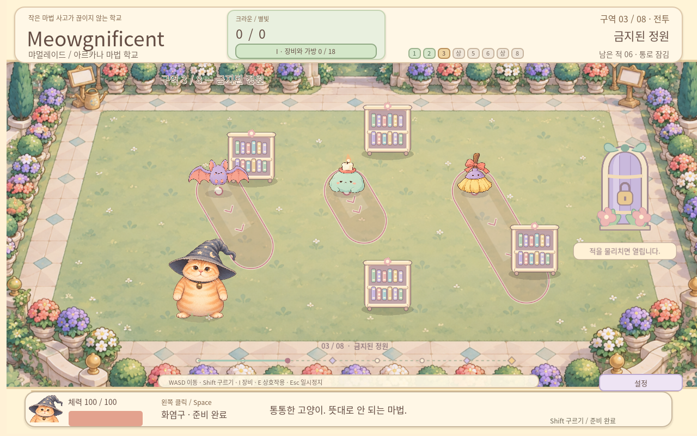

# Meowgnificent the wizard cat — v0.8.0

The approved round orange wizard cat keeps its original-meme identity and now shares the environments' soft pastel storybook paint treatment. Alternating planted steps replace the old whole-sprite waddle. Stage introductions use the same background artwork and decorations as their playable areas, with Korean and English descriptions tied to visible landmarks. Enemy warning lanes show the existing attack distance, width and locked direction with a readable windup progression.

Korean is the default UI and story language. Settings / F10 switches Korean or English immediately and saves the choice. The eight-area roguelite retains six fights, two shops, the final boss, nine pieces of illustrated gear and worn accessories. Crowns and equipment belong to the current expedition; Starlight and purchased legacy upgrades survive defeat.

Download a ZIP, extract it into a new folder, and launch the executable/app. No MSI installer or CMD download command is needed.

- [Meowgnificent-v0.8.0-windows.zip](https://github.com/forhide/Stone-Quotation/raw/refs/heads/meowgnificent-downloads-v0.8.0/Meowgnificent-v0.8.0-windows.zip)
- [Meowgnificent-v0.8.0-linux.zip](https://github.com/forhide/Stone-Quotation/raw/refs/heads/meowgnificent-downloads-v0.8.0/Meowgnificent-v0.8.0-linux.zip)
- [Meowgnificent-v0.8.0-macos.zip](https://github.com/forhide/Stone-Quotation/raw/refs/heads/meowgnificent-downloads-v0.8.0/Meowgnificent-v0.8.0-macos.zip)
- [Meowgnificent-v0.8.0-web.zip](https://github.com/forhide/Stone-Quotation/raw/refs/heads/meowgnificent-downloads-v0.8.0/Meowgnificent-v0.8.0-web.zip)
- [Meowgnificent-v0.8.0-source.zip](https://github.com/forhide/Stone-Quotation/raw/refs/heads/meowgnificent-downloads-v0.8.0/Meowgnificent-v0.8.0-source.zip)

Controls: WASD/arrows move, mouse aim, click/Space cast, Shift+direction roll, I equipment, E merchant/open exit, Enter start/next cleared area, M legacy studies, Esc close/pause, R abandon. Story: Enter/Space advance; Esc skip. F10: settings and language. Shop/legacy: click or1–4.

Validation: 584 source checks; 23 Windows/Wine and 23 Linux executable checks; 15 Web gameplay checks, 10 default-story English checks and 15 default Korean/language-switch/persistence Web checks. Mac package metadata, arm64, permissions and ad-hoc signature hashes are validated; actual Mac launch and native Windows hardware performance are untested. See QA-v0.8.0.md and qa/ for the exact scope, visual reviews and sequential render measurements.

The Mac app is ad-hoc signed and not Apple-notarized. Read PLAY-MACOS.txt in the ZIP. Checksums are in Meowgnificent-v0.8.0-SHA256SUMS.txt.

