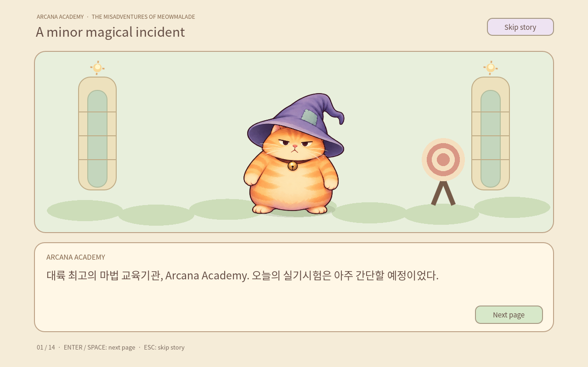
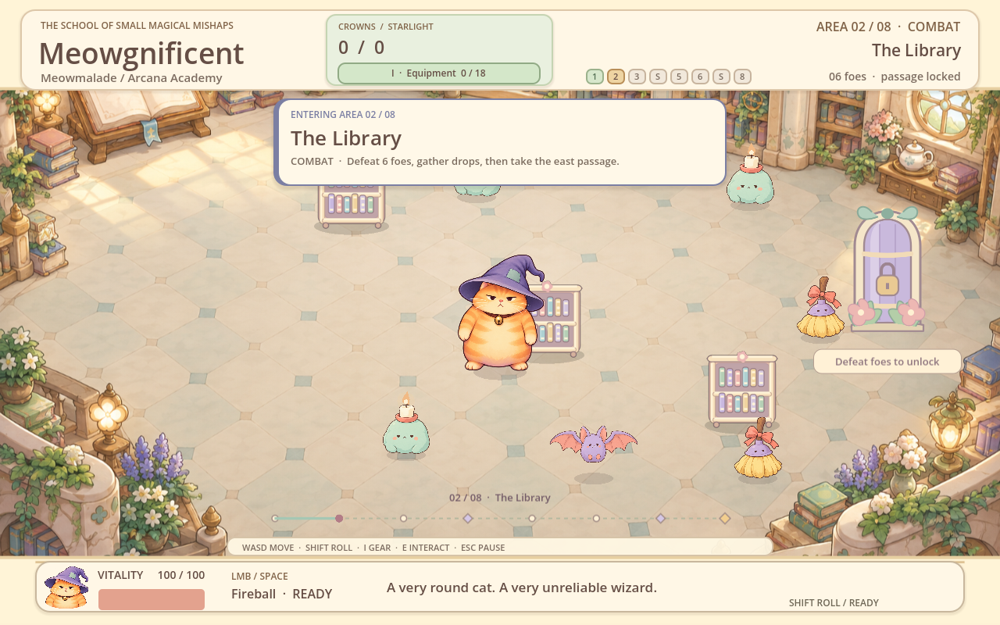
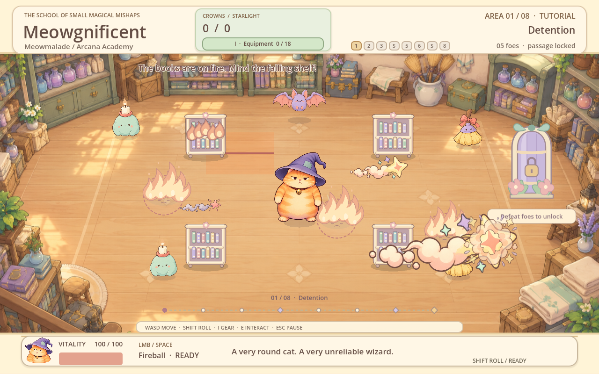

# Meowgnificent the wizard cat — v0.6.0

Meowmalade’s Misadventure: a modern HD pastel storybook overhaul with a deadpan orange SD wizard cat, illustrated Academy locations, rounded familiars and soft spell effects. Follow the Korean Academy opening, eight area chapters and final report-card ending. The Perfect Wizard predicts normal spells; clumsy accidents and openings after its attacks break its barrier.

The eight-area roguelite includes six fights and two shops. Crowns and equipment belong to the current expedition; Starlight and purchased legacy upgrades survive defeat. Ice, teleportation, summoning and the failed-wizard friends currently appear in the narrative; the playable spell is Fireball.

Download a ZIP below and extract it into a new folder. No installer or terminal download command is needed.

- [Meowgnificent-v0.6.0-windows.zip](https://github.com/forhide/Stone-Quotation/raw/refs/heads/meowgnificent-downloads-v0.6.0/Meowgnificent-v0.6.0-windows.zip)
- [Meowgnificent-v0.6.0-linux.zip](https://github.com/forhide/Stone-Quotation/raw/refs/heads/meowgnificent-downloads-v0.6.0/Meowgnificent-v0.6.0-linux.zip)
- [Meowgnificent-v0.6.0-macos.zip](https://github.com/forhide/Stone-Quotation/raw/refs/heads/meowgnificent-downloads-v0.6.0/Meowgnificent-v0.6.0-macos.zip)
- [Meowgnificent-v0.6.0-web.zip](https://github.com/forhide/Stone-Quotation/raw/refs/heads/meowgnificent-downloads-v0.6.0/Meowgnificent-v0.6.0-web.zip)
- [Meowgnificent-v0.6.0-source.zip](https://github.com/forhide/Stone-Quotation/raw/refs/heads/meowgnificent-downloads-v0.6.0/Meowgnificent-v0.6.0-source.zip)

Controls: WASD/arrows move, mouse aim, click/Space cast, Shift+direction roll, I equipment, E nearby merchant/open exit, Enter begin/next cleared area, M legacy studies from start/defeat/victory, Esc close/pause, R abandon. Story: Enter/Space advance; Esc skip. Shop/legacy: click or 1–4. F1/F2/F3 force the next spell outcome.

Validation: 451 source checks; 23 Windows/Wine executable checks; 23 Linux executable checks; 15 Chromium Web checks and 10 separate default-story Web checks. Desktop checks cover tutorial combat, area02 arrival, loot/equipment, defeat and permanent progress in a fresh process. Full eight-area flow, the boss interaction and story ending are covered by source integration, not a full-campaign desktop bot. Mac package metadata, arm64, executable permissions and signature hashes passed. Actual Mac launch and native Windows hardware performance were not tested. Performance comparison was mixed: tutorial timing was slower and the final-room rendering fixture was faster; no general FPS improvement is claimed. See QA-v0.6.0.md and qa/ for evidence.

The Mac app is ad-hoc signed, not Apple-notarized. Read PLAY-MACOS.txt in the ZIP for normal macOS opening instructions. SHA-256 values are in Meowgnificent-v0.6.0-SHA256SUMS.txt.

