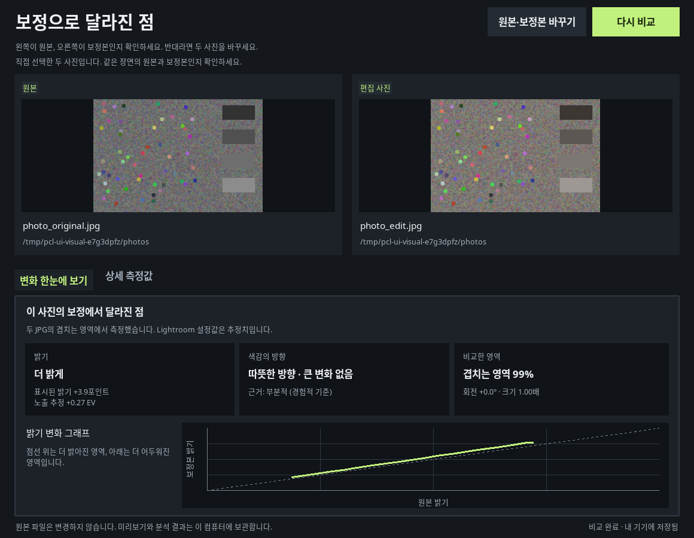

# Personal Color Lab 0.2.1 다운로드

UI와 UX를 개편한 오프라인 사진 비교 앱입니다. **사진 두 장 비교하기**를 누르고 원본 JPG와 보정 JPG를 선택하면 밝기·색감·비교 영역을 확인할 수 있습니다. 파일명이 다르거나 다른 폴더에 있어도 됩니다. 요약 카드와 밝기 그래프를 먼저 보여주며 상세 측정값은 별도 탭에서 볼 수 있습니다. 직접 고른 쌍은 현재 실행 중인 앱의 목록에서 다시 열 수 있습니다.

## 설치 파일 다운로드

| 대상 | 최소 운영체제 | 다운로드 |
| --- | --- | --- |
| Windows Intel/AMD 64비트 | Windows 10/11 | [Windows ZIP](https://github.com/forhide/Stone-Quotation/raw/refs/heads/personal-color-lab-downloads-v0.2.1/PersonalColorLab-0.2.1-windows-x64-download.zip) |
| Mac Apple Silicon | macOS 13 | [Apple Silicon ZIP](https://github.com/forhide/Stone-Quotation/raw/refs/heads/personal-color-lab-downloads-v0.2.1/PersonalColorLab-0.2.1-macos-arm64-download.zip) |
| Mac Intel | macOS 14 | [Intel Mac ZIP](https://github.com/forhide/Stone-Quotation/raw/refs/heads/personal-color-lab-downloads-v0.2.1/PersonalColorLab-0.2.1-macos-x64-download.zip) |

ZIP 압축을 풀고 Windows는 `.exe`, Mac은 CPU에 맞는 `.pkg`를 실행하세요. Python을 별도로 설치할 필요가 없습니다. 기존 앱을 종료한 후 새 설치 파일을 실행하면 됩니다. 사진 원본·기존 DB·설정은 유지됩니다. 기본 언어는 영어이며 한국어를 선택할 수 있습니다.

이 빌드는 **서명되지 않은 개발용 버전**입니다. 운영체제 확인 경고가 나타날 수 있으며 실제 Windows·macOS 기기의 설치·GUI 검증과 서명·공증은 아직 남아 있습니다. Windows ARM 에뮬레이션은 검증하지 않았습니다.

## 실제 앱 화면

아래는 실행 중인 Tk 데스크톱 앱의 캡처입니다. 비교 화면은 합성 테스트 사진을 사용했습니다.

[English workspace](preview/library-en.png) · [English comparison](preview/comparison-en.png)

## 검증과 소스

Linux 소스·GUI·아카이브 테스트 **175개가 모두 통과**했습니다. Windows는 Wine에서 새 설치 파일의 설치·재설치·직접 비교·요약·캐시·폴더 스캔·한국어·원본 보존·제거를 검증했습니다. macOS 두 패키지는 모든 파일 해시·권한·링크·BOM·버전·아이콘·번역을 확인했습니다. 실제 기기 실행과 구분한 상세 결과는 [VALIDATION.md](VALIDATION.md)에 있습니다.

- [설치·업데이트·제거 안내](INSTALLERS.md)
- [소스 및 빌드 도구 ZIP](https://github.com/forhide/Stone-Quotation/raw/refs/heads/personal-color-lab-downloads-v0.2.1/PersonalColorLab-0.2.1-source.zip)
- [ZIP SHA-256 체크섬](SHA256SUMS.txt)
- [자동 테스트 결과](source-tests.xml)

원본+보정 JPEG 분석을 지원하는 버전입니다. RAW 현상, 학습된 스타일 적용, XMP 내보내기는 후속 개발입니다. 앱은 사진을 업로드하지 않습니다.

이 브랜치는 다운로드와 검증 자료 전달용입니다. 저장소의 main 코드나 앱 개발용 CI를 변경하지 않습니다.
