# Personal Color Lab 0.5.6 다운로드

**RAW + JPG / RAW + XMP / 완성 JPG**에서 대비·채도·Vibrance·HSL과 **장면별 스타일**을 학습합니다. Clarity·Texture·선명도·노이즈 보정의 학습 근거와 실제 적용값도 확인할 수 있습니다. 낮·밤·풍경·인물·음식·사물 등21개 속성을 함께 사용하며, 자동 분류를 직접 수정할 수 있습니다. 분류 모델은 앱에 포함돼 CPU로 처리합니다. API·토큰 비용·설치 후 모델 다운로드가 필요 없습니다.

RAW + JPG는 전역 톤과 국부 대비를 분리해 대비가 중복 적용되는 현상을 줄였습니다. 기존 자료는 폴더를 다시 분석하고 새 스타일로 저장해야 추가 파라미터가 반영됩니다. 불확실한 선명도·노이즈는 추정 불가로 표시하며, Lightroom의 원래 슬라이더나 픽셀 결과를 정확히 복구한다는 뜻은 아닙니다.

| 운영체제 | 다운로드 |
|---|---|
| Windows10/11 64비트 | [설치 파일 ZIP](https://github.com/forhide/Stone-Quotation/raw/refs/heads/personal-color-lab-downloads-v0.5.6/PersonalColorLab-0.5.6-windows-x64-download.zip) |
| macOS Apple Silicon M1/M2/M3/M4, macOS13+ | [설치 파일 ZIP](https://github.com/forhide/Stone-Quotation/raw/refs/heads/personal-color-lab-downloads-v0.5.6/PersonalColorLab-0.5.6-macos-arm64-download.zip) |
| macOS Intel, macOS14+ | [설치 파일 ZIP](https://github.com/forhide/Stone-Quotation/raw/refs/heads/personal-color-lab-downloads-v0.5.6/PersonalColorLab-0.5.6-macos-x64-download.zip) |

[소스 ZIP](https://github.com/forhide/Stone-Quotation/raw/refs/heads/personal-color-lab-downloads-v0.5.6/PersonalColorLab-0.5.6-source.zip) · [해시](https://github.com/forhide/Stone-Quotation/raw/refs/heads/personal-color-lab-downloads-v0.5.6/SHA256SUMS.txt) · [설치 안내](INSTALLERS.md) · [검증 결과](VALIDATION.md)

ZIP을 다운로드하고 압축을 풀어 Windows는 setup.exe, Mac은 해당.pkg를 실행하세요. M1 Mac은 Apple Silicon 파일을 선택합니다. 앱은 서명·Apple 공증이 없는 개발 빌드이므로 OS 확인 경고가 표시될 수 있습니다. Mac의 내장 설치 데이터 경로 수정은 유지했습니다. Mac 패키지 구조 검증은 실제 Apple Installer 실행과 구별됩니다.

## 사용 순서

1. **스타일 만들기 → 폴더 선택** 후 RAW+JPG, RAW+XMP, 완성 JPG 방식 중 하나를 선택합니다.
2. 파일을 확인하고 필요한 짝을 지정합니다. **장면 분류 수정**으로 알고 있는 낮·밤·피사체 등을 선택하거나 자동으로 둡니다.
3. 분석 후 대비·채도·Clarity·Texture 카드와 장면별 자료 수를 확인합니다. 기록된 XMP 설정, 사진 쌍으로 추론한 변화, JPG의 최종 질감을 구분해 표시합니다. 측정 근거가 없는 값은 0으로 추정하지 않습니다.
4. 이름을 붙여 스타일을 저장하고 **스타일 적용 → 사진 선택**으로 새 RAW/JPG를 엽니다.
5. 현재 장면과 **적용 파라미터**에서 실제 보정값을 확인합니다. 분류를 직접 바꾸거나 자동으로 되돌릴 수 있습니다. Dehaze 등 픽셀 렌더러에서 지원하지 않는 기록값은 XMP에만 전달한다고 표시합니다.
6. 강도·혼합·객체 보정을 조절하고 전후 화면을 확인한 뒤 JPG 사본이나 XMP 프리셋을 저장합니다. 구도 변경은 색감만 적용이 기본값입니다.

장면별 보정은 **서로 다른 유효 원본3장 이상**부터 학습합니다. 복사본과 같은 RAW의 여러 편집본은 독립적인 원본 수로 세지 않습니다. 자료가 부족하거나 분류가 불확실하면 공통 스타일을 씁니다. 같은 원본의 서로 다른 편집은 장면 학습에서 보류하며 검토 사유를 표시합니다. 자동 분류 점수는 시각적 추정치이며 실제 촬영 시간이나 확정된 확률이 아닙니다. JPG만 사용할 때는 완성 사진의 조명·피사체·보정을 완전히 분리할 수 없습니다.

RAW 카메라·렌즈 자동 감지, 수동 선택, 검증된 프로필의 기본 왜곡 보정을 유지합니다. Sony A7CR 본체는 인식하지만 내장 공식 데이터에는 FE16–35mmF2.8GMII 보정치가 없어 GM I을 대신 사용하지 않습니다. XMP는 전역 색감의 근사 프리셋이며 Adobe 마스크나 Lensfun 워프를 포함하지 않습니다. 하늘·지형의 픽셀 분할은 아직 지원하지 않습니다.

RAW+JPG의 국부 대비·질감은 정렬된 이미지 차이에서 보수적으로 추론합니다. 리사이즈·정렬·클리핑·노이즈로 근거가 부족하면 선명도 등을 보류합니다. 완성 JPG만으로는 촬영·편집 이력을 복원할 수 없어 최종 질감 경향만 학습하고 임의로 선명도·노이즈 설정을 생성하지 않습니다. 모든 공간 보정은 자체 근사 렌더러이며 Lightroom과 동일한 픽셀이나 슬라이더를 보장하지 않습니다.

## 실제 앱 화면

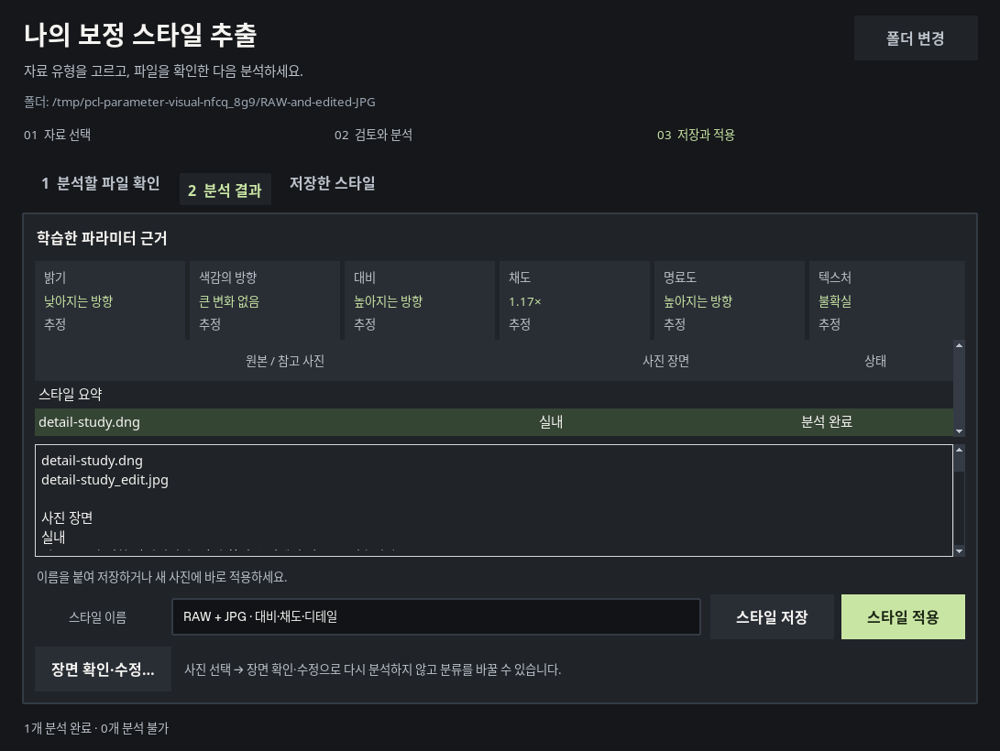

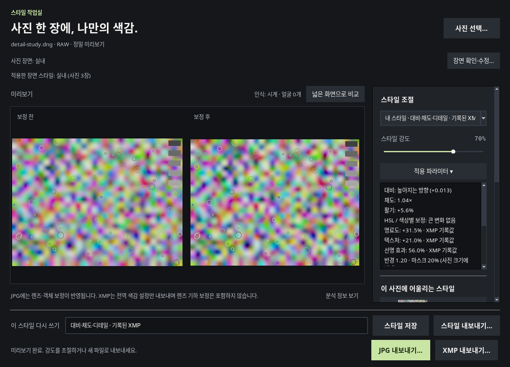

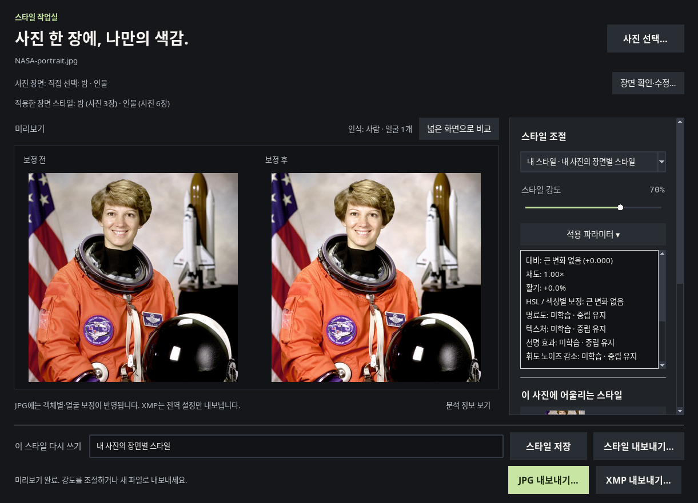

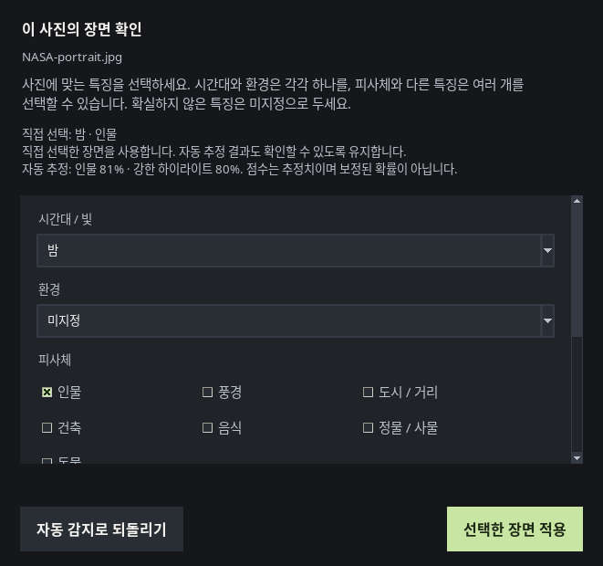

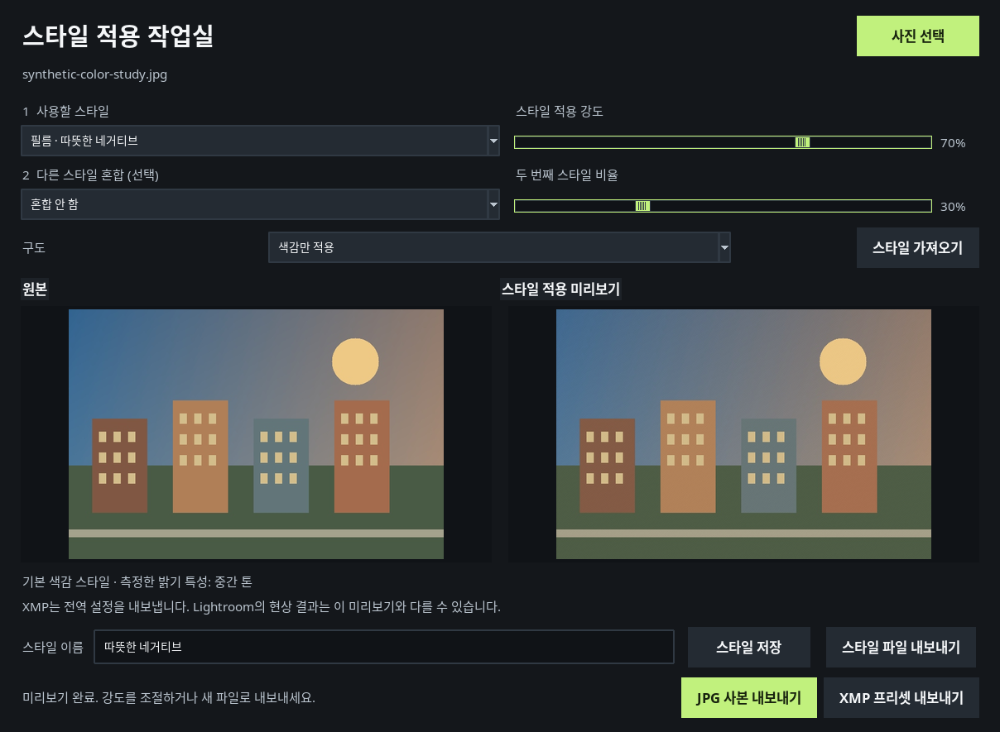

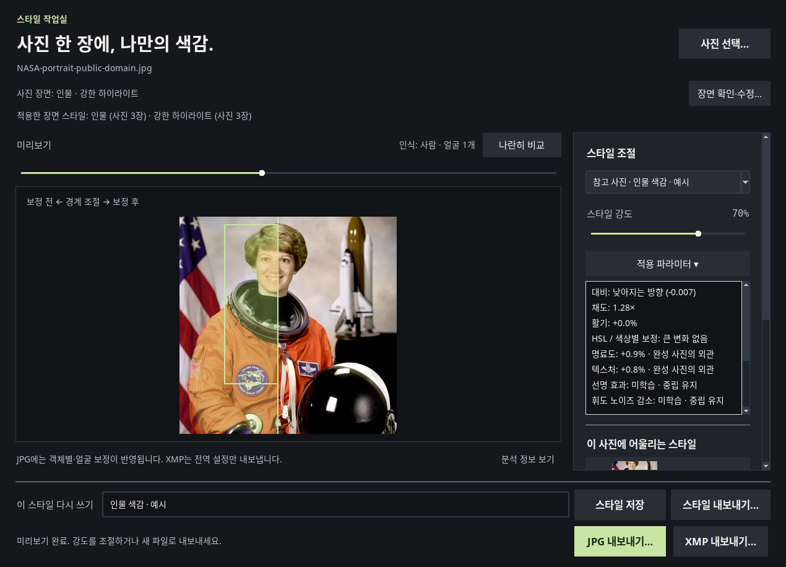

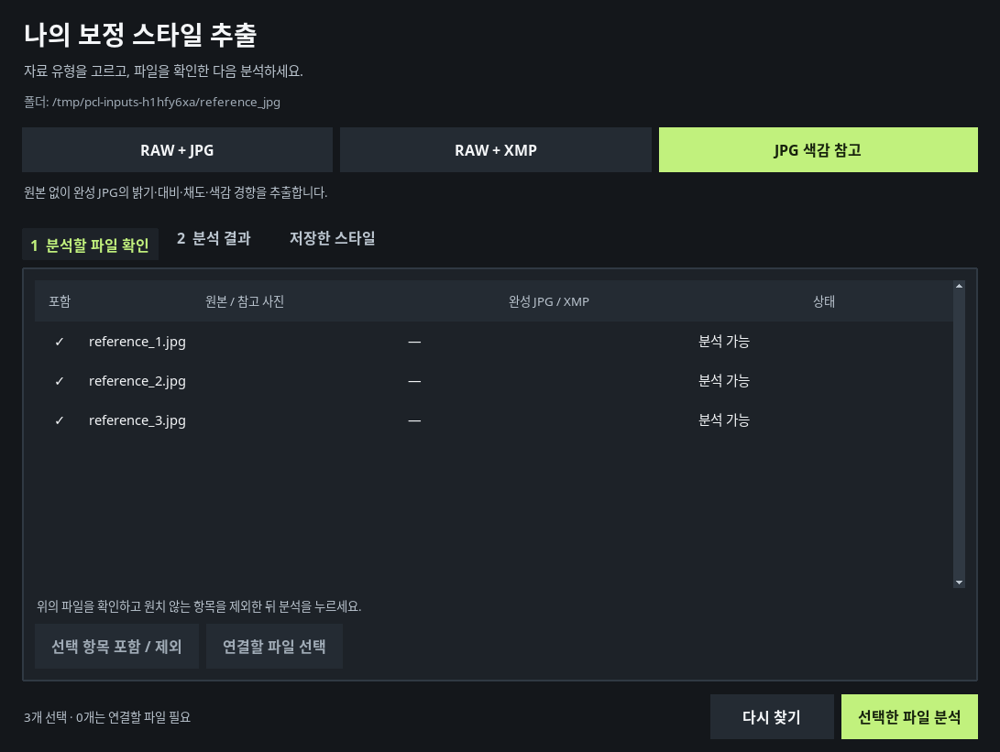

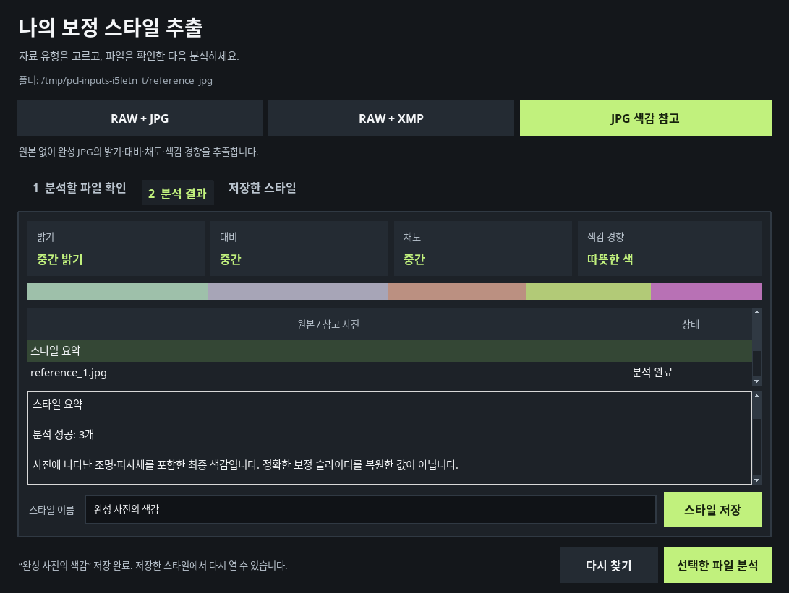

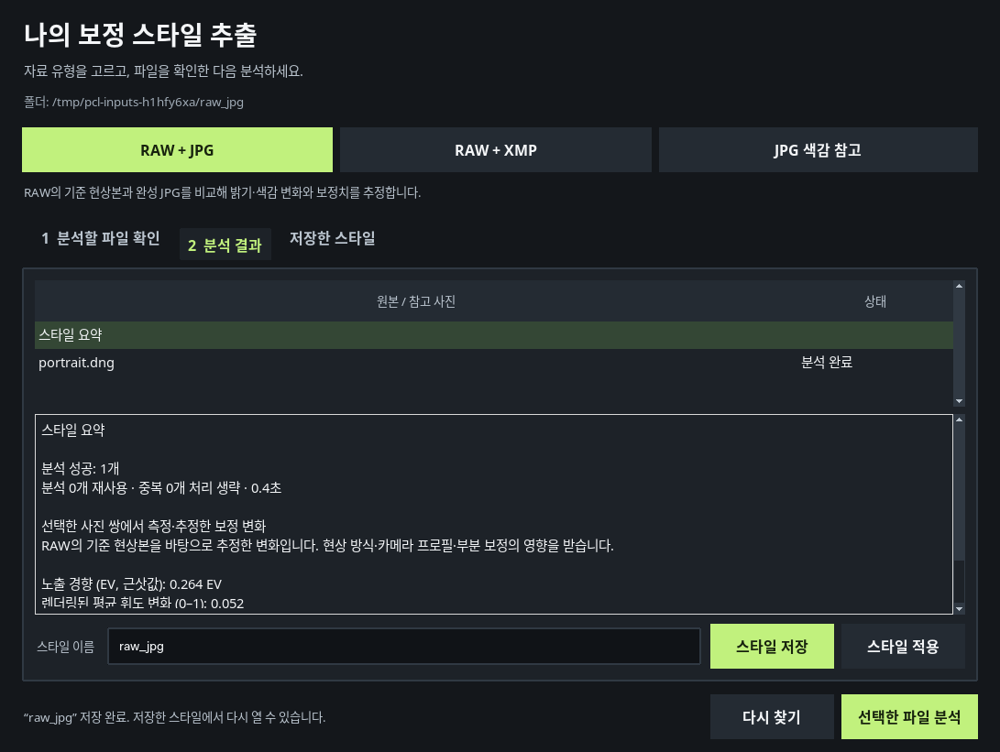

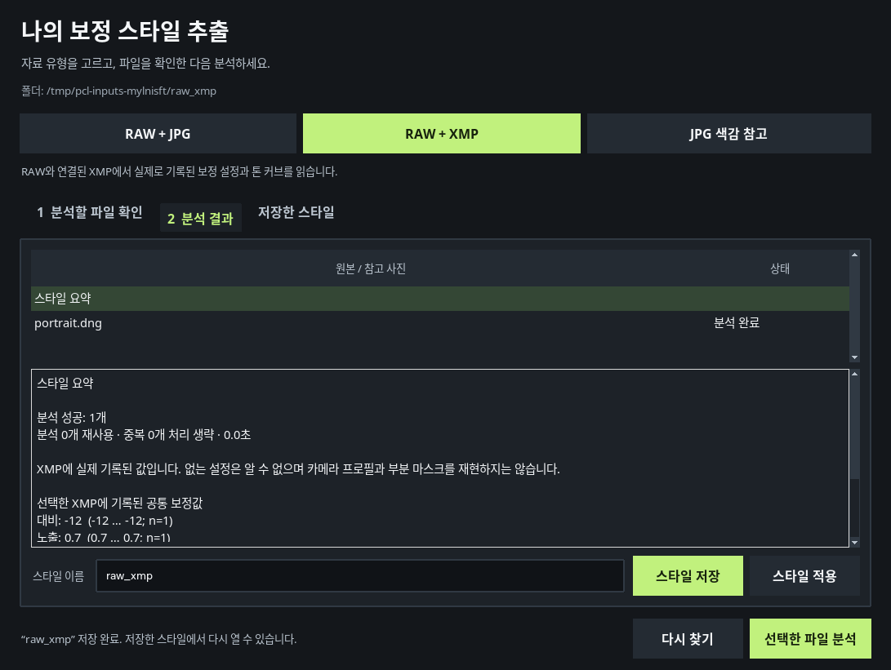

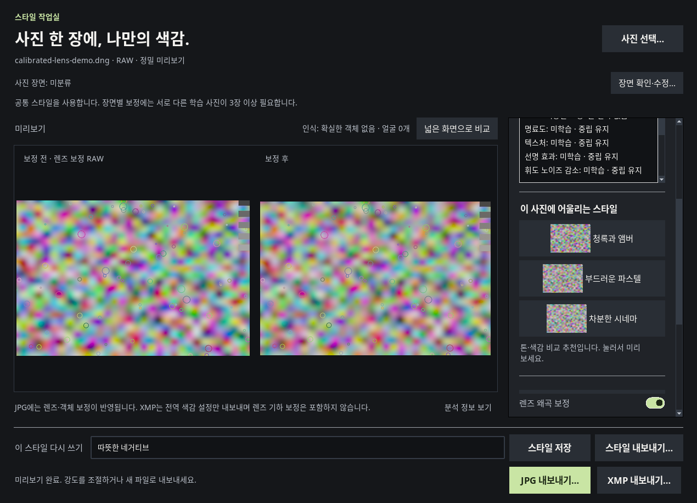

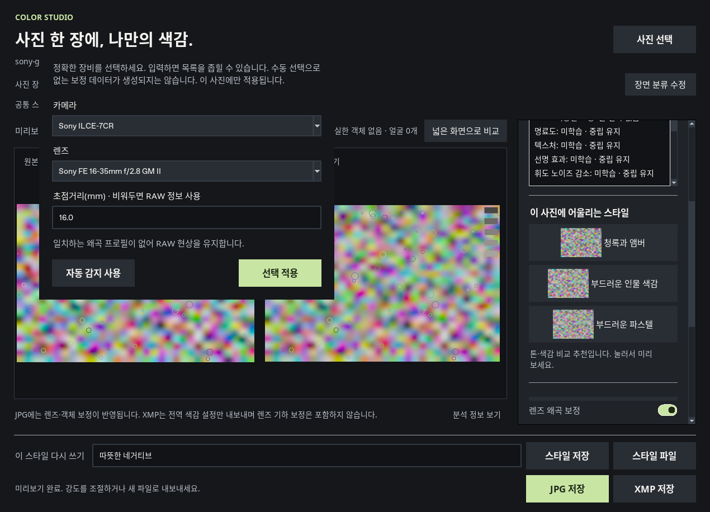

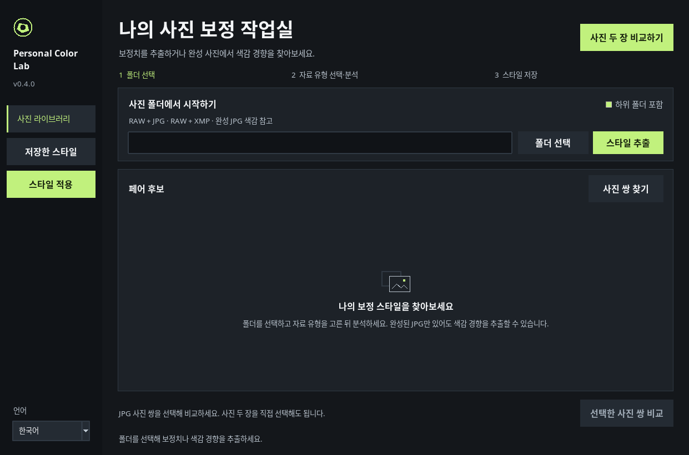

## 검증과 호환성

Linux/Xvfb 전체 테스트 **1194개 통과**, 실패·오류·건너뜀0개, 경고를 오류로 처리했습니다. Windows 설치본은 Wine10에서 설치·재설치·실제 GUI·내장 모델·세 장면 학습 경로·RAW·렌즈·다양한 파라미터 적용·데이터 보존 제거를 확인했습니다. Mac은 두 아키텍처 각각9개 구조 검사 통과입니다. 실제 Windows/macOS 하드웨어 설치, Apple 서명·공증과 실제 카메라 평가는 남아 있습니다.

공개 다운로드 링크 28개에서 HTTP 응답과 기준 바이트를 확인했습니다. 설치 ZIP은 부분 범위·파일 크기·형식을, 소스 ZIP과 작은 파일은 전체 바이트를 검증했습니다. [다운로드 검증 기록](download-validation.json)에서 확인할 수 있습니다.

SQLite3은 유지합니다. 새 스타일은 DNA4/엔진0.5.6이며, 이전 DNA1/2/3는 데이터를 수정하지 않고 기존 렌더링을 유지해 읽습니다. 추가 파라미터와 분리된 톤 곡선을 사용하려면 기존 폴더를 재분석하고 스타일을 새로 저장하세요. 장면 분류는 직접 검토할 수 있습니다. 다운그레이드 전에 사용자 데이터 폴더를 백업하세요.

Microsoft TinyCLIP MIT, OpenCV Zoo 모델의 MIT/Apache2.0, Lensfun XML의 CC-BY-SA3.0와 런타임 라이선스를 설치 파일에 포함합니다. 사진은 업로드하거나 원본을 수정하지 않습니다. NASA 공개 이미지가 사용된 화면 외에는 합성 테스트 자료입니다. 별도 외부 검사 사진은 앱에 배포하지 않습니다. 이 브랜치는 다운로드 전달용이며 저장소 main과 이전 배포 브랜치를 유지합니다.
