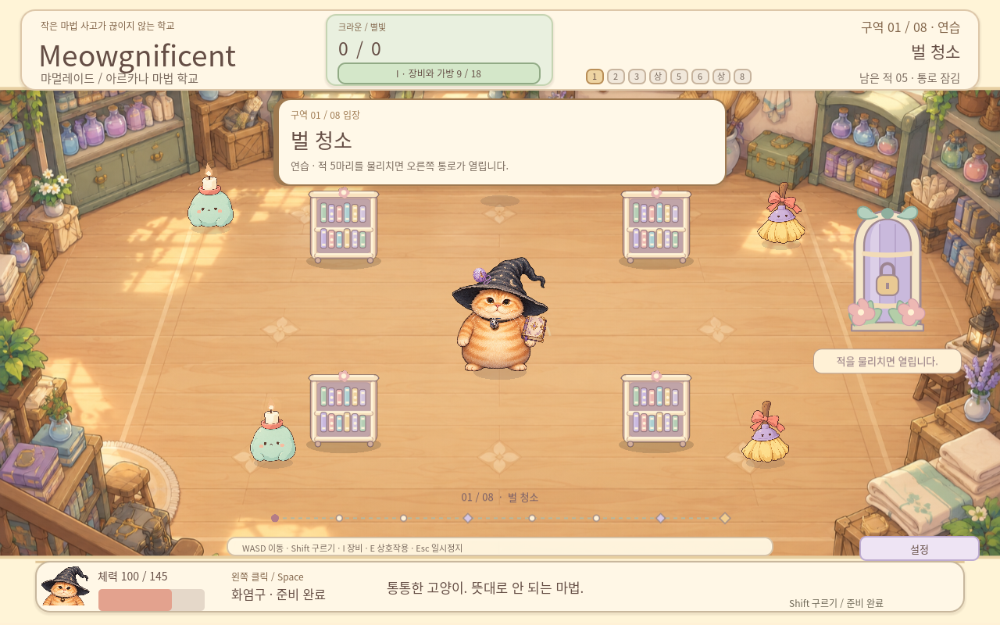

# Meowgnificent the wizard cat — v0.7.0

Illustrated story scenes, a wizard cat closer to the original meme, nine unique equipment icons and visible worn accessories. Korean is the default UI and story language. Settings / F10 switches Korean or English immediately and saves the choice for the next launch. All50 narrative pages have revised Korean and a complete English counterpart. Switching language during a story keeps the current page and pauses its timer while settings are open.

The eight-area roguelite retains six fights and two shops. Crowns and gear belong to the current expedition; Starlight and purchased legacy upgrades survive defeat. Wands/books appear beside a paw, collars at the neck and charms on the hat; removing or changing real equipment updates the appearance. Loose accessories tuck away during rolling and return afterward. Extra story spells and the failed-wizard friends remain narrative presentation rather than new playable spells or companion AI.

Download a ZIP and extract it into a new folder, then launch the executable/app.

- [Meowgnificent-v0.7.0-windows.zip](https://github.com/forhide/Stone-Quotation/raw/refs/heads/meowgnificent-downloads-v0.7.0/Meowgnificent-v0.7.0-windows.zip)
- [Meowgnificent-v0.7.0-linux.zip](https://github.com/forhide/Stone-Quotation/raw/refs/heads/meowgnificent-downloads-v0.7.0/Meowgnificent-v0.7.0-linux.zip)
- [Meowgnificent-v0.7.0-macos.zip](https://github.com/forhide/Stone-Quotation/raw/refs/heads/meowgnificent-downloads-v0.7.0/Meowgnificent-v0.7.0-macos.zip)
- [Meowgnificent-v0.7.0-web.zip](https://github.com/forhide/Stone-Quotation/raw/refs/heads/meowgnificent-downloads-v0.7.0/Meowgnificent-v0.7.0-web.zip)
- [Meowgnificent-v0.7.0-source.zip](https://github.com/forhide/Stone-Quotation/raw/refs/heads/meowgnificent-downloads-v0.7.0/Meowgnificent-v0.7.0-source.zip)

Controls: WASD/arrows move, mouse aim, click/Space cast, Shift+direction roll, I equipment, E merchant/open exit, Enter start/next cleared area, M legacy studies, Esc close/pause, R abandon. Story: Enter/Space advance; Esc skip. F10: settings and language. Shop/legacy: click or1–4.

Validation:497 source checks (451 game/story and46 localization/equipment appearance);23 Windows/Wine and23 Linux executable checks;15 Web gameplay checks,10 default-story English checks and15 default Korean/language-switch/persistence Web checks. Runtime desktop checks cover the tutorial, area02, drops/equipping, defeat and progress in a fresh process. Source integration covers the full route/boss/ending. Mac package metadata, arm64, permissions and signature hashes pass; actual Mac launch and native Windows hardware performance are untested. See QA-v0.7.0.md and qa/ for the exact scope and render-fixture measurements.

The Mac app is ad-hoc signed and not Apple-notarized. Read PLAY-MACOS.txt in the ZIP. Checksums are in Meowgnificent-v0.7.0-SHA256SUMS.txt.

