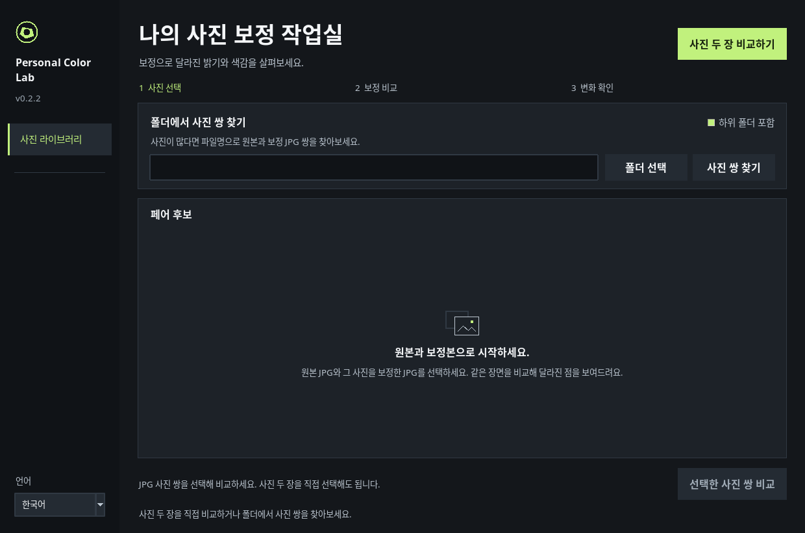
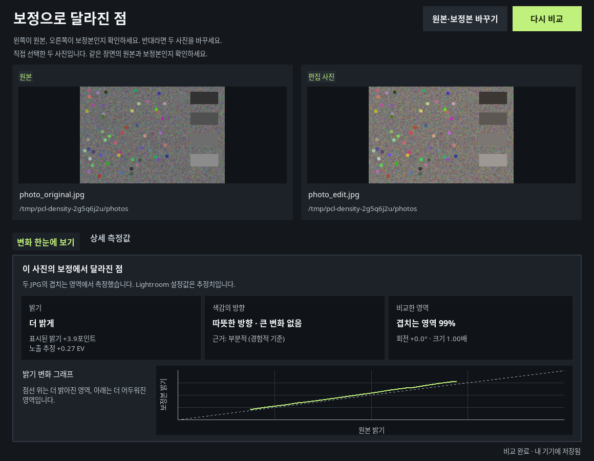

# Personal Color Lab 0.2.2 다운로드

글자 선명도와 가독성을 개선했습니다. Windows에서는 창을 만들기 전에 DPI 설정을 적용하고, 글꼴·여백·행 높이를 화면 배율에 맞춥니다. macOS는 시스템 글꼴과 네이티브 배율을 사용합니다. 작은 글씨 크기와 대비를 높였으며 **Offline only**와 중복 안내 문구를 제거했습니다.

## 설치 파일

| 대상 | 최소 운영체제 | 다운로드 |
| --- | --- | --- |
| Windows Intel/AMD 64비트 | Windows 10/11 | [Windows ZIP](https://github.com/forhide/Stone-Quotation/raw/refs/heads/personal-color-lab-downloads-v0.2.2/PersonalColorLab-0.2.2-windows-x64-download.zip) |
| Mac Apple Silicon | macOS 13 | [Apple Silicon ZIP](https://github.com/forhide/Stone-Quotation/raw/refs/heads/personal-color-lab-downloads-v0.2.2/PersonalColorLab-0.2.2-macos-arm64-download.zip) |
| Mac Intel | macOS 14 | [Intel Mac ZIP](https://github.com/forhide/Stone-Quotation/raw/refs/heads/personal-color-lab-downloads-v0.2.2/PersonalColorLab-0.2.2-macos-x64-download.zip) |

ZIP 압축을 풀고 Windows는 `.exe`, Mac은 CPU에 맞는 `.pkg`를 실행하세요. Python을 별도로 설치할 필요가 없습니다. 기존 앱을 종료한 후 설치하면 사진 원본·DB·설정은 유지됩니다. 기본 언어는 영어이며 앱에서 한국어를 선택할 수 있습니다.

서명되지 않은 개발용 설치 파일이므로 운영체제 확인 경고가 나타날 수 있습니다. 실제 Windows·macOS 기기의 설치, Mac Retina 화면, 서로 다른 배율의 모니터 간 이동은 아직 검증하지 않았습니다.

## 앱 화면

실행 중인 Tk 앱에서 직접 캡처했습니다. 비교 화면은 합성 테스트 사진을 사용했습니다.

[200% 작업실 화면](preview/library-ko-192dpi.png) · [200% 비교 화면](preview/comparison-ko-192dpi.png)

## 검증과 소스

Linux 소스·GUI·아카이브 테스트 **194개가 통과**했습니다. 영어·한국어 UI를 100%·150%·200% 배율로 검사했습니다. Windows는 Wine에서 설치·재설치·앱 실행·사진 비교·캐시·제거를 확인했고, macOS 두 패키지는 파일 해시·권한·링크·BOM을 검증했습니다. 실제 기기 검증 범위는 [VALIDATION.md](VALIDATION.md)에 명시했습니다.

- [설치·업데이트·제거 안내](INSTALLERS.md)
- [소스 및 빌드 도구 ZIP](https://github.com/forhide/Stone-Quotation/raw/refs/heads/personal-color-lab-downloads-v0.2.2/PersonalColorLab-0.2.2-source.zip)
- [ZIP SHA-256 체크섬](SHA256SUMS.txt)
- [자동 테스트 결과](source-tests.xml)

원본·보정 JPEG 두 장을 골라 밝기와 색감을 비교할 수 있습니다. 사진을 업로드하지 않습니다. RAW 현상, 학습한 스타일 적용, XMP 내보내기는 후속 개발 항목입니다.

이 브랜치는 다운로드와 검증 자료 전달용입니다. 저장소 main은 유지됩니다.
